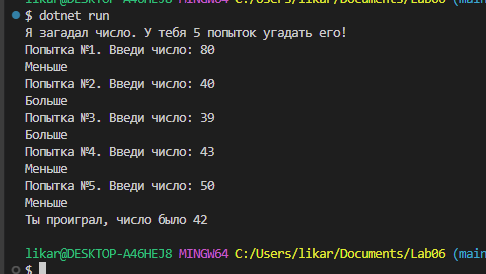
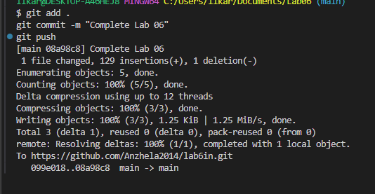

# лаба работа №6

**Выполнила:** резник анжелика ильинична

**Группа:** ИСп-242

## что сделано в лабе
- Познакомилась с циклами в c#
- Сделала задания на цикл for (вывела числа наоборот и четные до 50)
- Написала прогу с циклом while которая считает цифры и сумму
- Написала мини игру угадай чило за 5 попыток

## Скриншоты работы программы
Вот скриншот как работает код:

Скриншот терминала и гит:
